 

---

## 🧑‍💻 About Me

🌱 Started building apps at **age 11** and published them on the Play Store.  
🧩 Specialized in **Laravel systems** *and* **mobile apps**, building the backend and the app that talks to it.  
📱 Mobile: **Android**, **Flutter**, and **macOS / Swift**.  
🌐 Web: **Laravel**, **PHP**, and **WordPress**, backed by **PostgreSQL** and **MySQL**.  
🦀 Contributor to **Rust** and related open-source projects.  
💼 Open to collaborations, freelance projects, and engineering opportunities.

## 🚀 What I Build

---

## 🛠️ Tech Stack

### 📱 Mobile

  <picture>
    <source media="(prefers-color-scheme: dark)" srcset="https://skillicons.dev/icons?i=androidstudio,kotlin,java,flutter,dart,swift,apple&theme=dark&perline=7"/>
    <source media="(prefers-color-scheme: light)" srcset="https://skillicons.dev/icons?i=androidstudio,kotlin,java,flutter,dart,swift,apple&theme=light&perline=7"/>
    
  </picture>

### ⚙️ Backend, Databases & Systems

  <picture>
    <source media="(prefers-color-scheme: dark)" srcset="https://skillicons.dev/icons?i=laravel,php,wordpress,js,postgres,mysql,rust&theme=dark&perline=7"/>
    <source media="(prefers-color-scheme: light)" srcset="https://skillicons.dev/icons?i=laravel,php,wordpress,js,postgres,mysql,rust&theme=light&perline=7"/>
    
  </picture>

### 🎨 Frontend & Tools

  <picture>
    <source media="(prefers-color-scheme: dark)" srcset="https://skillicons.dev/icons?i=html,css,bootstrap,react,git,postman&theme=dark&perline=6"/>
    <source media="(prefers-color-scheme: light)" srcset="https://skillicons.dev/icons?i=html,css,bootstrap,react,git,postman&theme=light&perline=6"/>
    
  </picture>

---

## 📊 GitHub Statistics

  <picture>
    <source media="(prefers-color-scheme: dark)" srcset="https://stats-woad-two.vercel.app/api?username=Hevarh1&count_private=true&show_icons=true&theme=tokyonight&hide_border=true&title_color=58A6FF&icon_color=58A6FF&text_color=C9D1D9&include_all_commits=true"/>
    <source media="(prefers-color-scheme: light)" srcset="https://stats-woad-two.vercel.app/api?username=Hevarh1&count_private=true&show_icons=true&theme=default&hide_border=true&title_color=0969DA&icon_color=0969DA&text_color=24292F&include_all_commits=true"/>
    
  </picture>
  <picture>
    <source media="(prefers-color-scheme: dark)" srcset="https://streak-stats.demolab.com/?user=Hevarh1&theme=tokyonight&hide_border=true"/>
    <source media="(prefers-color-scheme: light)" srcset="https://streak-stats.demolab.com/?user=Hevarh1&theme=default&hide_border=true"/>
    
  </picture>

  <picture>
    <source media="(prefers-color-scheme: dark)" srcset="https://stats-woad-two.vercel.app/api/top-langs/?username=Hevarh1&count_private=true&layout=compact&theme=tokyonight&hide_border=true&title_color=58A6FF&text_color=C9D1D9"/>
    <source media="(prefers-color-scheme: light)" srcset="https://stats-woad-two.vercel.app/api/top-langs/?username=Hevarh1&count_private=true&layout=compact&theme=default&hide_border=true&title_color=0969DA&text_color=24292F"/>
    
  </picture>

### 📉 Contribution Graph
<picture>
  <source media="(prefers-color-scheme: dark)" srcset="https://github-activity-graph.vercel.app/graph?username=Hevarh1&theme=tokyo-night&bg_color=0d1117&color=58a6ff&line=79c0ff&point=1f6feb&area=true&hide_border=true"/>
  <source media="(prefers-color-scheme: light)" srcset="https://github-activity-graph.vercel.app/graph?username=Hevarh1&theme=github&bg_color=ffffff&color=0969da&line=0969da&point=1f6feb&area=true&hide_border=true"/>
  
</picture>

### 🐍 Contribution Snake
<picture>
  <source media="(prefers-color-scheme: dark)" srcset="https://raw.githubusercontent.com/Hevarh1/Hevarh1/output/github-snake-dark.svg"/>
  <source media="(prefers-color-scheme: light)" srcset="https://raw.githubusercontent.com/Hevarh1/Hevarh1/output/github-snake.svg"/>
  
</picture>

---

## 💼 Explore My Work

  
  &nbsp;
  

---

### 📫 Let's Connect

Open to collaborations, freelance work, and engineering roles.

**hevarh@gmail.com**

